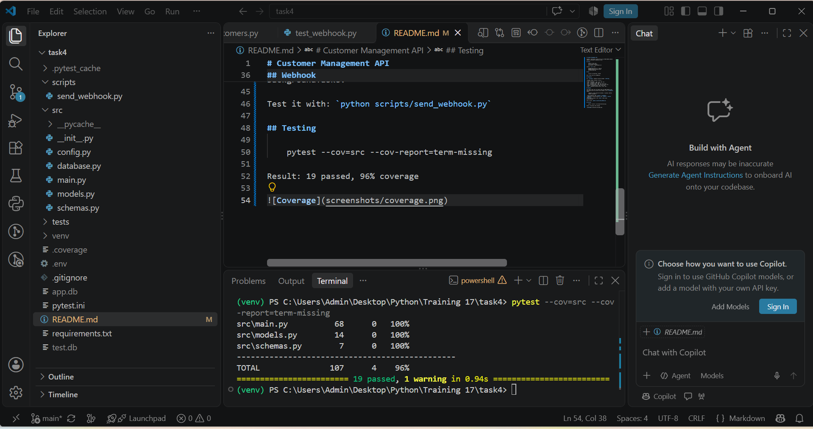

# Customer Management API

FastAPI + SQLAlchemy customer API with an HMAC-SHA256 webhook endpoint and pytest integration tests.

## Setup

    python -m venv venv
    venv\Scripts\activate
    pip install -r requirements.txt

Create a `.env` file:

    DATABASE_URL=sqlite:///./app.db
    WEBHOOK_SECRET=my-super-secret
    API_KEY=my-api-key

## Run

    uvicorn src.main:app --reload

Docs: http://127.0.0.1:8000/docs

## Endpoints

All `/customers` endpoints need the header `X-API-Key`.

| Method | Path | Success | Errors |
|---|---|---|---|
| POST | /customers | 201 | 401, 409, 422 |
| GET | /customers | 200 | 401 |
| GET | /customers/{id} | 200 | 401, 404, 422 |
| PUT | /customers/{id} | 200 | 401, 404, 409, 422 |
| DELETE | /customers/{id} | 204 | 401, 404 |
| POST | /webhooks/customer-events | 200 | 401 |

## Webhook

The sender signs the raw request body with HMAC-SHA256 using the shared secret and sends the hex digest in the `X-Signature` header.

    signature = hmac.new(secret.encode(), raw_body, hashlib.sha256).hexdigest()

- Valid signature: 200 `{"status": "accepted"}`
- Tampered or missing signature: 401 `{"detail": "Invalid signature"}`
- The event is saved in the `events` table using BackgroundTasks.

Test it with: `python scripts/send_webhook.py`

## Testing

    pytest --cov=src --cov-report=term-missing

Result: 19 passed, 96% coverage

